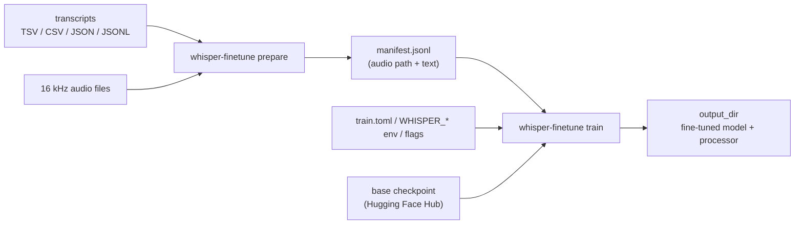

# whisper-finetune

A small command-line toolkit for fine-tuning OpenAI's Whisper speech-recognition
models on your own transcribed audio, built on Hugging Face `transformers` and
`datasets`.

This repository contains **training code only**. It does not ship a trained
model, weights or a dataset. You bring the audio and transcripts; the `train`
command downloads a base Whisper checkpoint from the Hugging Face Hub and
fine-tunes it. **Real training needs a GPU** (CUDA, or Apple Silicon via MPS
for small models). The CPU path exists for smoke tests and is far too slow for
real runs.

## How it works



1. **`prepare`** reads a transcript table, resolves each audio path, and writes
   a JSONL manifest. Rows with a missing audio file, an empty transcript or the
   wrong sampling rate are skipped and listed, so bad data is caught before a
   long training run.
2. **`train`** loads the manifest, turns each clip into log-mel features with
   Whisper's feature extractor, tokenizes the transcript, and runs
   `Seq2SeqTrainer`. Batches are padded per batch, and label padding is set to
   `-100` so it is ignored by the loss.

## Setup

Requires Python 3.12.

```bash
python3.12 -m venv .venv
. .venv/bin/activate
pip install -e ".[dev]"
```

`pip` installs the PyTorch build for your platform. On Linux with an NVIDIA GPU,
the default PyPI wheel includes CUDA; for other set-ups see
[pytorch.org/get-started](https://pytorch.org/get-started/locally/).

For gated or private checkpoints, copy `.env.example` to `.env`, set `HF_TOKEN`
and export it (`set -a; . ./.env; set +a`). The public `openai/whisper-*`
checkpoints need no token. The token is read by `huggingface_hub` itself and is
never logged.

## Usage

### 1. Build a manifest

Audio must be 16 kHz (mono or stereo; stereo is averaged to mono). Convert other
files first, for example with `ffmpeg -i in.mp3 -ar 16000 -ac 1 out.wav`.

```bash
# TSV without a header: <audio path>\t<transcript>
whisper-finetune prepare data/transcripts/combined.tsv \
    --audio-dir data/processed/audio \
    --output data/processed/manifest.jsonl
```

`--audio-dir` looks each file up by its name in that folder, which helps when
the transcript lists paths from another machine. Without it, relative paths
resolve against the transcript file's folder. CSV files work the same way
(`--header` skips a header row), and JSON/JSONL records need `audio` (or
`audio_path`) and `text` keys.

### 2. Check the settings with a dry run

`--dry-run` resolves the configuration and builds the trainer arguments without
downloading or loading a model:

```console
$ whisper-finetune train --config train.example.toml --dry-run
{
  "device": "cpu",
  "model": "openai/whisper-small",
  "manifest": "data/processed/manifest.jsonl",
  "language": null,
  "task": "transcribe",
  "training_arguments": {
    "output_dir": "models/whisper-small",
    "learning_rate": 1e-05,
    "warmup_steps": 50,
    "max_steps": 500,
    "per_device_train_batch_size": 8,
    "gradient_accumulation_steps": 2,
    "fp16": false,
    "use_cpu": true,
    "eval_strategy": "steps",
    "save_steps": 250,
    "seed": 42
  }
}
```

### 3. Train

```bash
whisper-finetune train --config train.example.toml --language urdu
```

The fine-tuned model and processor are saved to `output_dir`, with
intermediate checkpoints every `save_steps`. Load the result with
`WhisperForConditionalGeneration.from_pretrained("models/whisper-small")`.

## Configuration

Settings are merged in this order, later sources winning:

1. defaults in `src/whisper_finetune/config.py`;
2. a TOML file passed with `--config` (see `train.example.toml`);
3. environment variables: `WHISPER_MODEL`, `WHISPER_MANIFEST`,
   `WHISPER_OUTPUT_DIR`, `WHISPER_LANGUAGE`, `WHISPER_DEVICE`;
4. command-line flags (`whisper-finetune train --help` lists them all).

| Setting | Default | Notes |
| --- | --- | --- |
| `model_name` (`--model`) | `openai/whisper-small` | any Whisper checkpoint on the Hub or a local folder |
| `device` | `auto` | `auto` picks CUDA, then MPS, then CPU; fp16 is enabled only on CUDA |
| `language` / `task` | unset / `transcribe` | sets the decoder prompt for the target language |
| `max_steps` / `warmup_steps` | 500 / 50 | warm-up must be shorter than the run |
| `batch_size` × `gradient_accumulation_steps` | 1 × 2 | raise the batch size as far as GPU memory allows |
| `eval_fraction` | 0 | hold out this share of the manifest and evaluate loss every `save_steps` |
| `max_label_length` | 448 | Whisper's decoder limit; longer transcripts are truncated |

## Development

```bash
pytest          # offline: synthetic audio, fake tokenizer, no model downloads
ruff check .
ruff format --check .
```

The tests cover manifest building, the label-padding collator, audio loading,
configuration precedence, argument parsing and the dry run. Nothing in the test
suite touches the network or needs a GPU.

## Design notes

- **Fail early on data problems.** `prepare` checks every audio file's sampling
  rate from its header, and `train` refuses mismatched audio instead of
  feeding the feature extractor a spectrogram at the wrong rate.
- **Audio is read with `soundfile`** rather than `datasets`' `Audio` feature,
  which needs the extra `torchcodec` and FFmpeg libraries for decoding.
- **Labels are padded per batch, not to 448 tokens.** The original script
  padded every transcript to the maximum length with the pad token, so the
  loss was dominated by padding. The collator now pads to the longest label in
  the batch with `-100`.
- **Tokens stay in the environment.** Hub credentials are left to
  `huggingface_hub`, which reads `HF_TOKEN`; nothing in the code handles them.

## License

MIT, see [LICENSE](LICENSE).
